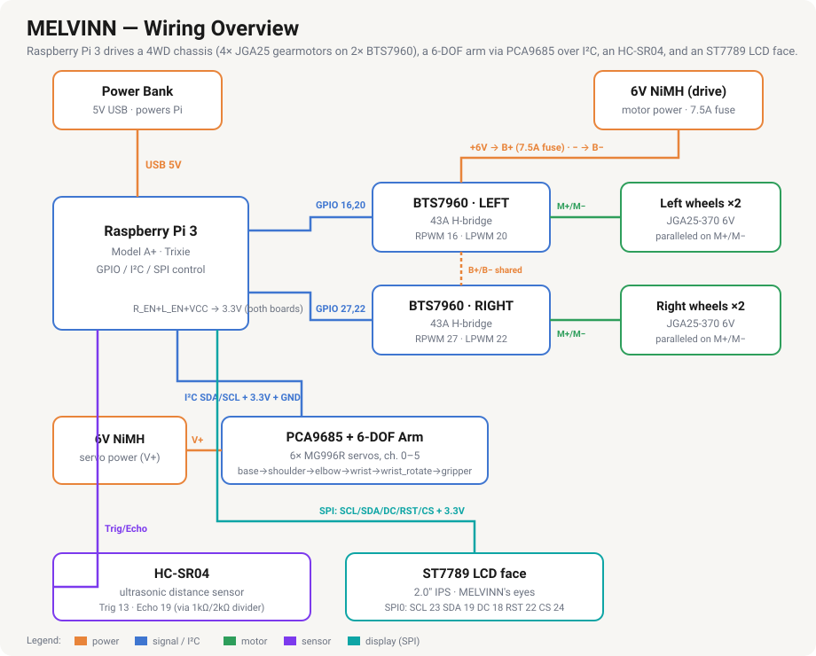

# Hardware — Bill of Materials

Everything needed to reproduce the robot car, plus the planned camera and arm
add-ons. Prices are rough estimates (Mexico, 2026, MercadoLibre/Amazon) and will
vary — use them for budgeting, not exact quotes.

## Wiring overview

If the diagram doesn't render inline, open [docs/wiring-overview.svg](docs/wiring-overview.svg) directly.

---

## Core build (the driving car)

| # | Component | Qty | What it's for | Approx. (MXN) |
|---|-----------|-----|---------------|---------------|
| 1 | Raspberry Pi 3 (Model A+, 3B, or 3B+) | 1 | The brain — runs the control code | 700–1000 |
| 2 | microSD card, 16 GB+ (Class 10/A1) | 1 | Operating system (Raspberry Pi OS Lite, Trixie) | 120–200 |
| 3 | USB power bank, 5V / 2A+ | 1 | Powers the Pi (kept separate from motor power) | 200–450 |
| 4 | 2WD robot car chassis kit | 1 | Frame, 2× TT gear motors, 2 wheels, caster, AA holder | 150–350 |
| 5 | L9110S dual H-bridge motor driver | 1 | Lets the Pi drive both motors forward/back | 30–60 |
| 6 | AA batteries | 4 | Motor power (~6V), via the holder in the kit | 40–80 |
| 7 | Dupont jumper wires (M–F & F–F, 40+) | 1 set | Pi GPIO ↔ L9110S, battery joins | 80–120 |

> The chassis kit (#4) usually bundles the motors, wheels, caster, and AA holder.
> If you buy parts separately you'll also need 2× TT gear motors + wheels.

## Optional — camera (vision)

| # | Component | Qty | What it's for | Approx. (MXN) |
|---|-----------|-----|---------------|---------------|
| 8 | Camera Module v2 / **IMX219** module + ribbon — bought: [Arducam 8MP IMX219 (B09V576TFN)](https://www.amazon.com.mx/dp/B09V576TFN), 20"/500mm flex cable | 1 | Live video / vision on the Pi | 260–555 |

> ⚠️ Avoid generic **OV5647 "v1.3" clones** — ours was detected over I²C but never
> streamed (CSI-2 timeout) and could not be fixed in software. The **IMX219**
> sensor works out of the box on Trixie. Match the ribbon cable to the Pi 3
> (15-pin, standard CSI).

## Robotic arm — working ✅

| # | Component | Qty | What it's for | Approx. (MXN) |
|---|-----------|-----|---------------|---------------|
| 9 | 6-DOF robotic arm kit (6× MG996R servos) — bought: [MLM2080598029](https://www.mercadolibre.com.mx/brazo-robotico-de-6-grados-dof-de-libertad-servomotor/p/MLM2080598029) | 1 | The arm itself | ~775 |
| 10 | PCA9685 16-channel servo driver — bought: [MLM2040047104](https://www.mercadolibre.com.mx/pca9685-modulo-pwm-16-canales-12-bits-i2c/p/MLM2040047104) | 1 | Drives the servos over I²C (the Pi has only 2 hardware PWM pins) | 60–100 |
| 11 | 6V 2200 mAh NiMH battery pack — bought: **Blomiky 2-pack, SM-2P plug + USB charging cable** | 1 (or 2-pack) | Servo power (5–6V). MG996R are current-hungry — never run off the Pi | ~560 (2-pack) |
| 12 | SM-2P connector pair (pigtail) — bought: **yueton 10-pair SM-2P male/female** | 1 | Adapts the battery's SM plug to the PCA9685 screw terminal without cutting it | ~100 |
| — | Raspberry Pi Pico W *(alternative)* | 1 | Can generate the servo PWM instead of the PCA9685 — see [docs/pico-setup.md](docs/pico-setup.md) | 120–180 |

> **Servo power:** a 6V NiMH pack connects **straight to the PCA9685 V+** (no
> regulator — 6V is in the MG996R range). **Don't cut the battery's SM plug** (the
> USB charger uses it); wire an **SM-2P pigtail** into the PCA9685 screw terminal
> instead — **red → V+, black → GND**. A small AA NiMH pack is fine for testing /
> light moves; for strong, sustained 6-servo motion, step up to a **2S LiPo + a
> 5–6V UBEC (5A+)**.
>
> Pi → PCA9685 (I²C), physical pin numbers: `pin 1 (3.3V)→VCC`, `pin 20 (GND)→GND`,
> `pin 3 (SDA)→SDA`, `pin 5 (SCL)→SCL`.
> Servos plug onto channels 0–5, in order: **base, shoulder, elbow, wrist,
> wrist_rotate, gripper** (`ARM_JOINTS` in `robot_code/assistant.py`) — this
> order was confirmed empirically with `arm_jog_test.py` on the rebuilt arm
> (don't assume it from the kit's mechanical layout; it depends purely on
> which wire is plugged into which PCA9685 channel).
>
> **Confirmed working:** all 6 joints — including `wrist_rotate` (channel 4) —
> move correctly via [`robot_code/tests/arm_test.py`](robot_code/tests/arm_test.py)
> and [`robot_code/tests/arm_jog_test.py`](robot_code/tests/arm_jog_test.py).
> (One early gripper wiring issue turned out to be a loose connector, not a
> code or channel problem.) `robot_move_arm()` in `assistant.py` drives the
> same PCA9685 code path, so voice/typed commands like *"move the shoulder to
> 45"* work end to end.

## Voice assistant (audio) — working ✅

| # | Component | Qty | What it's for | Approx. (MXN) |
|---|-----------|-----|---------------|---------------|
| 13 | USB conference speakerphone (mic + speaker) | 1 | Voice in **and** out over one USB plug (e.g. Techwolf TWA-Y02) | ~470 |
| 14 | USB hub (USB-A) | 1 | The Pi 3A+ has one USB port — the hub runs the speakerphone + Pico together | ~120 |

> **We chose USB audio over the I²S kit.** The INMP441 + MAX98357 boards need
> their headers **soldered** and would collide with Motor A on GPIO20. A USB
> speakerphone is plug-and-play (USB-audio-class → works on the Pi), needs no
> soldering, and touches no GPIO. Confirm the speakerphone's cable ends in
> **USB-A** (or add a USB-C→USB-A adapter). The I²S kit is set aside for later.
>
> **Confirmed working:** the BY `Y02` enumerates as ALSA **card 1** (`plughw:1,0`)
> for both mic and speaker; record + playback tested. Setup / test commands are in
> [docs/voice-assistant.md](docs/voice-assistant.md).

## Obstacle sensing (ultrasonic) — working ✅

| # | Component | Qty | What it's for | Approx. (MXN) |
|---|-----------|-----|---------------|---------------|
| 15 | HC-SR04 ultrasonic distance sensor | 1 | Sonar: measure distance; stop / turn before hitting things | 30–60 |
| 16 | 1 kΩ + 2 kΩ resistors — from the **REXQualis 650-pc / 22-value 1/4W kit** (has 1 kΩ ×50 and 2 kΩ ×25) **or** a logic level shifter | 1 each | Drop the 5 V **Echo** pin to 3.3 V so it's safe for the Pi | ~99 (whole kit) |

> ⚠️ **Protect the Pi:** the HC-SR04's **Echo** pin outputs **5 V**, but Pi GPIO
> tolerates only **3.3 V**. Put a voltage divider on Echo (`Echo →1 kΩ→ GPIO`, then
> `GPIO →2 kΩ→ GND`) — or use an **HC-SR04*P*** / 3.3 V board and skip it.
>
> **Confirmed wiring** (physical Pi pin numbers): `VCC → pin 2` (5V), `GND →
> pin 34`, `Trig → pin 33` (GPIO13 BCM), `Echo → pin 35` (GPIO19 BCM) — with
> the divider's 1 kΩ leg between Echo and pin 35, and its 2 kΩ leg from pin 35
> down to `GND → pin 39`. Avoid the motor pins (16, 20, 27, 22 — BCM).
>
> **Confirmed working:** [`robot_code/obstacle_avoid.py`](robot_code/obstacle_avoid.py)
> reads distance with `gpiozero.DistanceSensor(echo=19, trigger=13)` and stops +
> turns the robot when something is closer than 25 cm.

## Software / accounts

- **Anthropic API key** *(optional)* — only for the smart Claude brain in
  `robot_code/assistant.py`. The robot runs fully **offline and free** without it.
  See [docs/voice-assistant.md](docs/voice-assistant.md).

---

## Tools

- Small flat screwdriver (for the L9110S screw terminals)
- Electrical tape (to join bare battery wires to jumpers)
- A computer with [Raspberry Pi Imager](https://www.raspberrypi.com/software/) (flash the SD card)
- *(Optional)* soldering iron — only needed for add-ons like a WS2812B LED strip

## Wiring quick reference

Pi GPIO → L9110S (BCM numbers):

| L9110S pin | Pi pin | GPIO |
|------------|--------|------|
| A-1A | 36 | GPIO16 |
| A-1B | 38 | GPIO20 |
| B-1A | 13 | GPIO27 |
| B-2A | 15 | GPIO22 |
| GND  | 6  | (ground) |

Power: battery **+** → L9110S **VCC**, battery **−** → Pi **pin 9** (GND).
The Pi is powered separately by the USB power bank.

See [`robot_code/tests/motor_test.py`](robot_code/tests/motor_test.py) for the matching code,
and run [`setup.sh`](setup.sh) once to install dependencies.
