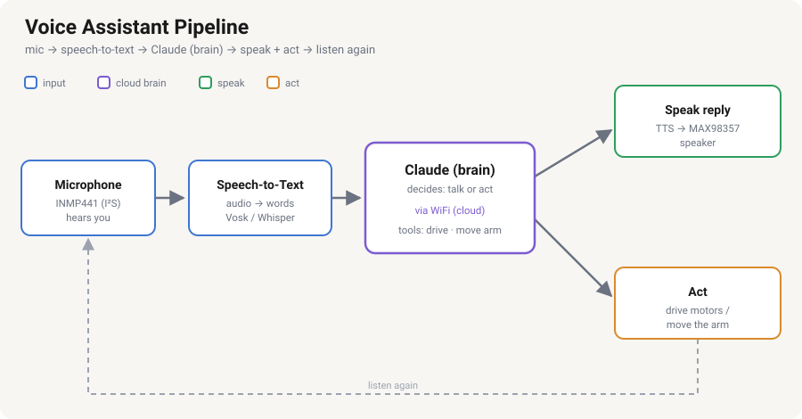

# Voice Assistant — Design

Talk to the robot: it listens, thinks, answers out loud, and acts (drives, moves
the arm, plays music). Working end to end — see [robot_code/tests/assistant.py](../robot_code/tests/assistant.py).

## Pipeline



```
mic → Vosk speech-to-text → brain (Claude, or offline rules) → speak reply + act → listen again
```

1. **Listen** — capture audio from the USB speakerphone mic.
2. **Speech-to-text (STT)** — **Vosk** (offline, on the Pi) turns audio into text.
3. **Think** — the text goes to the brain, which decides whether to just talk or
   to *act*, calling robot tools (`drive`, `move_arm`, `play_song`, …) when it
   should. Two brains, automatic fallback: **Claude API** (smart, needs a key)
   or **offline keyword rules** (free, no key/internet needed).
4. **Act + speak** — run any tool calls (motors / arm / music) and read the
   reply aloud through the USB speakerphone (Piper if installed, else espeak-ng).
5. **Loop** — go back to listening.

Claude (when available) runs in the cloud — the Pi 3A+ can't run a large model
locally — but the robot **always responds**, even fully offline: STT (Vosk), the
fallback brain, and TTS (espeak-ng) all run on-device with no internet needed.

## The brain — Claude API with tool use (+ offline fallback)

[robot_code/tests/assistant.py](../robot_code/tests/assistant.py) uses the Anthropic Python
SDK and the **tool-use loop**: Claude receives the request and can call tools
that map to robot functions. If no key is set (or a call fails), it falls back
to `local_brain()` — a standard-library keyword parser with the same tools.

Tools exposed to Claude:

| Tool | Maps to | Status |
|------|---------|--------|
| `drive(direction, seconds)` | the L9110S motors | ✅ working |
| `move_arm(joint, angle)` | a PCA9685 servo channel | ✅ working — all 6 joints tested |
| `play_song(query)` / `download_song(query)` / `stop_music()` | mpg123 / yt-dlp | ✅ working |

The loop: send transcript → if Claude returns `tool_use`, run the tool and feed
the result back → repeat until Claude returns a normal reply → speak it.

### Model choice

`assistant.py` defaults to **`claude-haiku-4-5`** — fastest + cheapest, best for a
snappy voice loop. Change the `MODEL` constant for more capability:

| Model | Use when |
|-------|----------|
| `claude-haiku-4-5` | fastest + cheapest — **the default**, good for snappy voice |
| `claude-sonnet-4-6` | balanced speed / cost |
| `claude-opus-4-8` | best quality |

### Setup

On the Pi, use a virtualenv that can **still see the system `gpiozero`** (Trixie's
system Python is externally managed):

```bash
python3 -m venv --system-site-packages ~/venv
source ~/venv/bin/activate
pip install anthropic                    # gpiozero / lgpio come from the system
export ANTHROPIC_API_KEY=sk-ant-...      # keep this secret; don't commit it
```

Offline mode needs none of this — just run `python3 robot_code/tests/assistant.py` with
the system Python (no venv, no key).

## Offline fallback (free — no API, no internet)

`robot_code/tests/assistant.py` has a **second brain**: a standard-library keyword
parser (`local_brain`) that runs whenever the Claude SDK isn't installed, no
`ANTHROPIC_API_KEY` is set, or a Claude call fails. It understands the basic
commands — `forward`, `back`, `left`, `right`, `stop`, and arm moves — and drives
the motors directly. So the robot always responds to simple commands (and `stop`
acts **instantly**, before Claude is even consulted), and upgrades to full natural
language when Claude is available. Offline mode needs no key, no WiFi, and no pip
installs — just run `python3 robot_code/tests/assistant.py` with the system Python.

## Speech-to-text (STT) options

| Option | Runs | Notes |
|--------|------|-------|
| **Vosk** | offline, on the Pi | ✅ **What we use.** Lightweight, works on the Pi 3, no internet needed. |
| Cloud STT API | needs WiFi | Higher accuracy, more setup, per-use cost. Not used. |

## Text-to-speech (TTS) options

| Option | Runs | Notes |
|--------|------|-------|
| **Piper** | offline, on the Pi | Natural-sounding neural voice, reasonable on the Pi 3. |
| **espeak-ng** | offline, on the Pi | Robotic but tiny and instant — simplest to start with. |
| Cloud TTS API | needs WiFi | Best quality, per-use cost. |

## Audio hardware — USB speakerphone (working ✅)

We use a **USB conference speakerphone** (BY `Y02`) for both mic and speaker — one
USB plug, no soldering, no GPIO use. It runs through a **USB hub** (the Pi 3A+ has
only one USB port, shared with the Pico). Confirmed working on Raspberry Pi OS
Trixie. (This replaces the earlier INMP441/MAX98357 I²S kit, which needed
soldering and collided with Motor A on GPIO20.)

**Detect it** (after plugging the hub + speakerphone in):
```bash
lsusb                # lists the hub + the "Y02" speakerphone
arecord -l           # capture (mic):     card 1: Y02 ...
aplay -l             # playback (speaker): card 1: Y02 ...
```
Both mic and speaker enumerate as **card 1**, so the ALSA device is `plughw:1,0`
(the `plughw` plugin auto-converts sample rate / format).

**Record + play back test:**
```bash
arecord -D plughw:1,0 -f S16_LE -c 1 -r 16000 -d 5 ~/test.wav   # speak for 5 s
aplay   -D plughw:1,0 ~/test.wav
```

> ⚠️ **Silent at first?** A fresh USB audio device is usually muted / at zero
> volume. Run `alsamixer -c 1`, press `F5` to show all controls, then raise **and
> unmute** (`M`) both the playback and capture levels and press `Esc`. Also check
> the speakerphone's own physical mute / volume buttons.

**Make it talk (TTS):**
```bash
sudo apt install -y espeak-ng
espeak-ng "Hello, I am your robot." --stdout | aplay -D plughw:1,0
```
Piping through `aplay -D plughw:1,0` routes speech to the USB speaker (not the
Pi's headphone jack). `assistant.py`'s `speak()` already prefers **Piper** for a
natural voice — install Piper + a voice model and point `PIPER_MODEL` at the
`.onnx` file — and falls back to espeak-ng automatically when Piper isn't set up.

> **Don't put secrets in the repo.** Keep `ANTHROPIC_API_KEY` in the environment
> (or a `.env` that's git-ignored), never in committed code.

## Build order

1. ✅ Drive (motors) — done
2. ✅ Audio I/O — USB speakerphone mic + speaker record/play back cleanly
3. ✅ Text brain — type a command, robot acts + speaks (Claude, or offline fallback)
4. ✅ Voice — mic → Vosk speech-to-text; talk instead of type (`assistant.py`, voice mode by default)
5. ✅ Arm (PCA9685 + servos) — all 6 joints tested, wired into the assistant
6. ✅ Obstacle sensing (HC-SR04) — stop/turn before hitting things
7. ✅ Music — play/download songs by voice (yt-dlp + mpg123)
8. ⏳ Add the camera as another tool (let Claude "look" by sending a frame)
